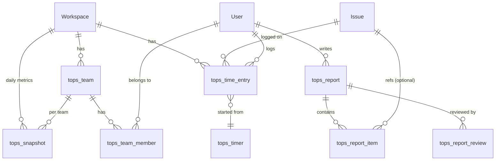

# طراحی معماری ماژول «عملیات تیم» (Team Ops) برای پلین

وضعیت: **پیش‌نویس برای تأیید**. تا تأیید این سند هیچ کدی نوشته نمی‌شود.
پایه‌ی بررسی: فورک محلی، برنچ `preview`، کامیت `b98e1defb`، نسخه‌ی `1.5.0`.

---

## ۱. یافته‌های تحلیل

### ۱.۱ ساختار ریپو

مونوریپو با pnpm و turbo: `apps/` (api, web, admin, space, live, proxy) و `packages/` (types, services, shared-state, i18n, blocks, ...). مجوز AGPL-3.0 است و هر فایل هدر SPDX دارد.

### ۱.۲ بک‌اند (`apps/api/plane`)

- Django + DRF + Celery، با اپ‌های `app`, `api`, `db`, `bgtasks`, `authentication`, `analytics`, `space`, `license`.
- **همه‌ی مدل‌ها در یک اپ (`plane.db`) و یک زنجیره‌ی مایگریشن** هستند. آخرین مایگریشن: `0125`.
- API داخلی وب زیر `/api/` (اپ `plane.app`) و API عمومی با توکن زیر `/api/v1/` (اپ `plane.api`) است.
- مدل پایه `BaseModel`: کلید UUID، `created_at/updated_at`، `created_by/updated_by` (خودکار با `crum`) و حذف نرم (`deleted_at`).
- `ProjectBaseModel` فیلدهای `project` و `workspace` را می‌دهد و `workspace` را خودکار از پروژه پر می‌کند.
- **Celery beat** برنامه‌ی زمان‌بندی در `celery.py` دارد و `autodiscover_tasks()` فعال است.

### ۱.۳ احراز هویت و دسترسی

- احراز هویت با نشست (`SessionAuthentication`) برای وب و `X-Api-Key` برای API عمومی.
- نقش‌ها عددی‌اند: `Admin=20`، `Member=15`، `Guest=5`، هم در `WorkspaceMember` و هم در `ProjectMember` (فیلد `is_active`).
- تزئین‌گر `allow_permission([ROLE.ADMIN, ...], level="WORKSPACE"|"PROJECT", creator=..., model=...)` و کلاس‌های `WorkSpace*Permission` / `Project*Permission` در `app/permissions/`.
- ادمین ورک‌اسپیس در سطح پروژه هم عبور می‌کند به شرط عضویت در پروژه.

### ۱.۴ مدل‌های Work Item

- `Issue` (جدول `issues`): `state`, `priority`, `start_date`, `target_date`, `estimate_point`, `parent`, `type`, `assignees` (M2M با `IssueAssignee`), `labels`, `completed_at`, `archived_at`.
- مدل‌های وابسته: `IssueActivity`, `IssueComment`, `IssueAttachment`, `IssueSubscriber`, `IssueVersion`، و `Cycle`/`Module` برای برنامه‌ریزی.
- **زمان‌سنجی وجود ندارد.** جستجو برای worklog/timesheet فقط به `exporter.py` و سریالایزر cycle/project رسید که ربطی ندارند.
- مدل `Team` در `db/models/workspace.py` وجود دارد (جدول `teams`: نام، توضیح، ورک‌اسپیس، لوگو) ولی **هیچ API یا استفاده‌ای در `app/` و `api/` ندارد**. یعنی عملاً بلااستفاده است.

### ۱.۵ فرانت‌اند (`apps/web`)

- React Router v7 (Vite). مسیرها در `app/routes/core.ts` و **نقطه‌ی افزونه‌ی رسمی `app/routes/extended.ts`** که الان خالی است و با `mergeRoutes` ادغام می‌شود.
- ناوبری: `components/navigation/*` و `app/(all)/[workspaceSlug]/(projects)/_sidebar.tsx`.
- لایه‌ها: `packages/types` (نوع‌ها)، `packages/services` و `apps/web/services` (فراخوانی API)، `apps/web/store` (MobX)، `packages/i18n` (ترجمه).
- از قبل بخش‌های Analytics، Notifications و Workspace Views در ناوبری هستند.

### ۱.۶ اختلاف با سرور

سرور روی مایگریشن `0121` است و فورک روی `0125`. چهار مایگریشن اختلاف دارند:
`0122` (تغییر M2M‌های assignees)، `0123` (حذف فیلد از ApiToken، **مخرب**)، `0124` (ایندکس)، `0125` (ریست هویت deploy board، **تغییر داده**).
محتوای دقیق این‌ها باید قبل از اولین استقرار خوانده و روی کپی دیتابیس تست شود (بخش ۹).

---

## ۲. اصل طراحی: افزونه‌ی ماژولار بدون دست‌زدن به Core

**یک اپ Django جدید و مستقل به نام `plane.team_ops`** با مدل‌ها، مایگریشن‌ها، URLها و تسک‌های خودش.

- مایگریشن‌های آن در زنجیره‌ی جدا (`team_ops/migrations`) هستند، پس زنجیره‌ی `plane.db` تغییر نمی‌کند و ادغام با آپ‌استریم ساده می‌ماند.
- جدول‌ها با پیشوند `tops_` ساخته می‌شوند. FKها به Core با رشته‌ی `"db.Issue"` و `settings.AUTH_USER_MODEL` هستند، و **هیچ ستونی از جداول Core عوض نمی‌شود**.
- نقاط تماس با Core فقط این‌هاست:
  1. یک خط در `INSTALLED_APPS` (`settings/common.py`)
  2. یک خط در `urls.py` (`path("api/", include("plane.team_ops.urls"))`)
  3. ثبت تسک‌های beat در `celery.py`
  4. `extended.ts` و چند آیتم ناوبری در فرانت
- مجوزها را از `plane.app.permissions` و `ROLE` دوباره استفاده می‌کنیم و دوباره‌نویسی نمی‌کنیم.
- ویژگی را با `TEAM_OPS_ENABLED` (متغیر محیطی) خاموش/روشن می‌کنیم تا در صورت مشکل بدون عوض کردن ایمیج غیرفعال شود.

---

## ۳. ERD جداول جدید



| جدول                 | فیلدهای کلیدی                                                                                                                        | نکته                                                   |
| -------------------- | ------------------------------------------------------------------------------------------------------------------------------------ | ------------------------------------------------------ |
| `tops_time_entry`    | workspace, project, issue (null)، user، `started_at`، `ended_at`، `duration_seconds`، `note`، `source` (manual/timer)، `is_billable` | ثبت دستی و تایمر. قید: بازه‌ی منفی ممنوع.              |
| `tops_timer`         | user، issue، `started_at`                                                                                                            | حداکثر یک تایمر فعال برای هر کاربر (قید یکتا).         |
| `tops_report`        | workspace, user, `kind` (daily/weekly)، `period_start`، `period_end`، `status` (draft/submitted/reviewed)، `summary`                 | یکتا بر `(user, kind, period_start)`.                  |
| `tops_report_item`   | report، issue (null)، `text`، `hours`                                                                                                | موارد کاری گزارش.                                      |
| `tops_report_review` | report، reviewer، `comment`، `decision`                                                                                              | بازخورد مدیر.                                          |
| `tops_team`          | workspace، name، description، lead                                                                                                   | **تصمیم لازم:** بخش ۱۰، مورد ۱.                        |
| `tops_team_member`   | team، user، role (lead/member)                                                                                                       |                                                        |
| `tops_snapshot`      | workspace، team (null)، `date`، `metrics` (JSON)                                                                                     | عکس روزانه برای داشبورد؛ از اسکن سنگین جلوگیری می‌کند. |

همه‌ی مدل‌ها از `BaseModel` ارث می‌برند (UUID، audit، حذف نرم). فایل‌ها و اعلان‌ها جدول جدید نمی‌خواهند، بخش ۶ و ۷ را ببینید.

---

## ۴. قراردادهای API

مسیر پایه: `/api/workspaces/<slug>/team-ops/` (API وب با نشست). نسخه‌ی توکنی `/api/v1/...` در فاز بعد، اگر لازم شد.

| ماژول   | مسیر                            | متدها                                             | دسترسی                                     |
| ------- | ------------------------------- | ------------------------------------------------- | ------------------------------------------ |
| زمان    | `time-entries/`                 | GET (فیلتر user, issue, project, from, to) / POST | Member+: فقط ورودی خودش؛ Admin: همه        |
|         | `time-entries/<id>/`            | PATCH / DELETE                                    | صاحب ورودی یا Admin                        |
|         | `timer/`                        | GET / POST (start) / DELETE (stop و ثبت)          | Member+                                    |
| گزارش   | `reports/`                      | GET / POST                                        | Member+ برای خودش؛ Admin/Lead برای تیم     |
|         | `reports/<id>/submit/`          | POST                                              | صاحب                                       |
|         | `reports/<id>/review/`          | POST                                              | Lead تیم یا Admin                          |
| داشبورد | `dashboard/summary/`            | GET (`team`, `from`, `to`)                        | Admin / Lead                               |
|         | `dashboard/members/`            | GET                                               | Admin / Lead                               |
| تیم     | `teams/`، `teams/<id>/members/` | CRUD                                              | خواندن: Member+؛ نوشتن: Admin              |
| پیشرفت  | `progress/projects/<id>/`       | GET                                               | عضو پروژه                                  |
|         | `progress/export/`              | POST                                              | Admin (از مسیر exporter موجود استفاده شود) |

قواعد مشترک: صفحه‌بندی با الگوی Plane (`cursor`)، پاسخ خطا مثل Core، و همه‌ی کوئری‌ها با `workspace__slug` فیلتر می‌شوند تا نشت بین ورک‌اسپیس‌ها نداشته باشیم.

---

## ۵. ساختار پوشه‌ها

```
apps/api/plane/team_ops/
├── apps.py                # AppConfig
├── models/                # time_entry.py, report.py, team.py, snapshot.py
├── migrations/            # زنجیره‌ی مستقل
├── serializers/
├── views/                 # هر ماژول یک فایل
├── permissions.py         # لایه‌ی نازک روی plane.app.permissions
├── urls.py
├── services/              # منطق کسب‌وکار (محاسبه‌ی مجموع، خلاصه‌سازی)
├── bgtasks/               # snapshot_task.py, reminder_task.py
└── tests/                 # unit/ و contract/

packages/types/src/team-ops/        # نوع‌ها
packages/services/src/team-ops/     # کلاینت API
apps/web/store/team-ops/            # MobX
apps/web/components/team-ops/       # UI
apps/web/app/(all)/[workspaceSlug]/(projects)/team-ops/   # صفحه‌ها
apps/web/app/routes/extended.ts     # ثبت مسیرها
packages/i18n/src/locales/*         # کلیدهای ترجمه (فارسی و انگلیسی؛ طبق اسکیل translate)
docs/team-ops/                      # مستندات هر مرحله
```

---

## ۶. صفحه‌ها و جریان کاربری

1. **زمان من** (`/team-ops/time`): تایمر شروع/توقف، ثبت دستی، جدول هفتگی. در صفحه‌ی Work Item هم یک دکمه‌ی تایمر و مجموع زمان اضافه می‌شود (از طریق نقطه‌ی افزونه‌ی همان صفحه، با کمترین تغییر).
2. **گزارش‌ها** (`/team-ops/reports`): ساخت پیش‌نویس روزانه (با پیشنهاد خودکار از Work Itemهای تغییرکرده و زمان‌های ثبت‌شده)، ارسال، و دیدن بازخورد.
3. **داشبورد مدیریت** (`/team-ops/dashboard`): ساعت کار هر عضو، گزارش‌های ثبت‌نشده، بار کاری، فیلتر تیم و بازه.
4. **تیم‌ها** (`/team-ops/teams`): تعریف تیم و سرپرست و اعضا.
5. **پیشرفت پروژه** (`/team-ops/progress`): تلفیق داده‌ی cycle/module/state موجود با زمان صرف‌شده؛ نمودار burn-down و مقایسه‌ی برآورد با واقعی.

همکاری تیمی (ماژول ۴) و فایل (ماژول ۵) تا حد ممکن از امکانات موجود (کامنت، منشن، پیوست Work Item) استفاده می‌کنند و فقط نمای تیمی اضافه می‌شود. جزئیات در مرحله‌ی خودش و پس از تأیید.

---

## ۷. سیستم دسترسی

| نقش در ورک‌اسپیس | زمان     | گزارش         | داشبورد                      | تیم    |
| ---------------- | -------- | ------------- | ---------------------------- | ------ |
| Admin (20)       | همه      | همه و بازبینی | کامل                         | مدیریت |
| Member (15)      | فقط خودش | فقط خودش      | فقط اگر Lead باشد (تیم خودش) | خواندن |
| Guest (5)        | ممنوع    | ممنوع         | ممنوع                        | ممنوع  |

- سرپرست تیم (`lead`) فقط روی اعضای تیم خودش دید و بازبینی دارد.
- قاعده‌ی «Guest ممنوع» به‌صورت پیش‌فرض در یک کلاس permission مرکزی اعمال می‌شود.
- هیچ نقش جدیدی در Core ساخته نمی‌شود. سطح Lead فقط در `tops_team_member` است.

اعلان‌ها (ماژول ۷): استفاده‌ی مجدد از مدل `Notification` موجود با `entity_name` اختصاصی (`team_ops_report` و ...) و تسک Celery برای یادآوری گزارش. اگر رابط اعلان‌ها entity ناشناخته را درست نشان ندهد، تغییر کوچکی در رندر فرانت لازم است. این در مرحله‌ی هفتم بررسی می‌شود.

فایل‌ها (ماژول ۵): `FileAsset` نیاز به مقدار جدید در `EntityTypeContext` دارد که یک مایگریشن فقط-choices در `plane.db` می‌سازد (بدون تغییر ستون). جایگزین: فایل‌های گزارش را به همان `ISSUE_ATTACHMENT` وصل کنیم. تصمیم در مرحله‌ی پنجم.

---

## ۸. استراتژی تست

- **بک‌اند:** pytest با فیکسچرهای موجود (`plane/tests/conftest.py`, `factories.py`). برای هر ماژول: unit برای سرویس‌ها، contract برای API، و تست صریح دسترسی (Guest/Member/Admin و ورک‌اسپیس دیگر).
- **فرانت:** تست واحد برای store و کامپوننت‌ها با ابزار موجود در بسته‌ی مربوط، به‌علاوه‌ی `pnpm check` (lint/format/types).
- اجرا طبق `AGENTS.md`: `docker compose -f docker-compose-test.yml run --rm --build api-tests pytest -m unit`.

---

## ۹. برنامه‌ی Migration و Backup

**قبل از هر مایگریشن روی هر محیط:** `pg_dump -Fc` تازه + آرشیو آپلودها + کپی env/compose (همان روشی که برای سرور انجام شد؛ بکاپ فعلی: `/home/e200/plane-backup-20261030-191400/` و نسخه‌ی محلی `C:\Users\Hamid\plane-server-backup-20261030\`).

**مراحل:**

1. **توسعه محلی** با دیتابیس محلی.
2. **Staging:** Postgres جدا (کانتینر محلی یا روی سرور با پورت و نام پروژه‌ی دیگر)، **restore بکاپ واقعی سرور** در آن، اجرای مایگریشن‌های `0122–0125` و سپس مایگریشن `team_ops`. بررسی شمار ردیف‌های جداول اصلی قبل/بعد.
3. **استقرار روی سرور:** ایمیج‌های ساخته‌شده از فورک (api/worker/beat/web) با تگ ثابت، تعویض `image:` در compose، بدون `down -v`.
4. **برگشت:** ایمیج قدیمی + restore بکاپ (چون مایگریشن‌های جدید با ایمیج قدیمی ناسازگارند).

**اصل:** مایگریشن‌های `team_ops` فقط ایجاد جدول هستند (افزایشی). حذف یا تغییر ستون Core ممنوع است.

---

## ۱۰. تصمیم‌هایی که تأیید شما لازم دارند

1. **تیم‌ها:** (الف) جدول جدید `tops_team` که با Core کاملاً جداست **(پیشنهاد من)**؛ یا (ب) استفاده از مدل بلااستفاده‌ی `Team` موجود. (ب) جدول کمتر می‌سازد ولی به Core وابسته می‌کند و احتمال تداخل با آپ‌استریم دارد.
2. **شروع از مرحله‌ی ۱ (Time Tracking)** و تحویل کامل آن (مدل، API، UI، تست، مستند) قبل از رفتن سراغ ماژول بعدی؟ **(پیشنهاد من: بله)**
3. **زبان رابط:** کلیدهای ترجمه‌ی فارسی و انگلیسی، با فارسی به‌عنوان زبان اصلی این ماژول؟
4. **واحد زمان و منطقه:** ثبت زمان با ثانیه و ذخیره‌ی UTC، نمایش بر اساس منطقه‌ی زمانی کاربر (تقویم میلادی؛ نمایش تقویم شمسی خارج از این فاز)؟
5. **Staging:** روی سیستم خودتان با Docker کافی است یا یک استک جدا روی سرور می‌خواهید؟
6. **مجوز AGPL §13:** چون کاربران از راه شبکه با نسخه‌ی تغییریافته کار می‌کنند، باید سورس فورک برای آن‌ها در دسترس باشد (مثلاً مخزن GitHub فورک و لینک در رابط). هدر SPDX فایل‌های جدید را هم مثل بقیه‌ی ریپو می‌گذاریم.

---

## ۱۱. ریسک‌ها

| ریسک                                     | کاهش                                                                        |
| ---------------------------------------- | --------------------------------------------------------------------------- |
| مایگریشن‌های `0122–0125` روی دیتای واقعی | تست روی بکاپ restoreشده قبل از سرور؛ بکاپ تازه قبل از استقرار               |
| تداخل با آپ‌استریم هنگام merge           | اپ مستقل، نقاط تماس حداقل (۴ مورد بخش ۲)                                    |
| بار سنگین داشبورد روی دیتابیس            | جدول `tops_snapshot` و ایندکس‌های مناسب، نه اسکن زنده                       |
| نشت داده بین ورک‌اسپیس‌ها                | فیلتر اجباری slug و تست صریح                                                |
| ایمیج‌ها ۵ ماه از نسخه‌ی رسمی عقب‌اند    | بعد از استقرار فورک، به‌روزرسانی از آپ‌استریم کار شما می‌شود؛ برنامه‌اش جدا |
