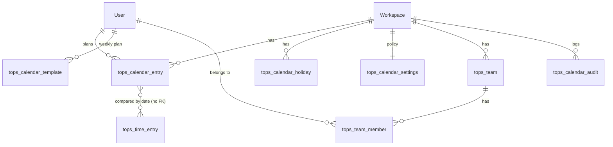

# Stage 2: Work Calendar — Design (for approval)

Status: **approved (D1–D7 as recommended) and implemented.** This is the design as approved; the as-built description, with the small differences, is in [STAGE-2-WORK-CALENDAR.md](STAGE-2-WORK-CALENDAR.md).
Builds on: Stage 1 (Time Tracking), `docs/team-ops/ARCHITECTURE.md`.

All UI text, code, comments and docs of this stage are English only (see decision D1).

## 1. Goal and scope

A calendar inside Plane where each specialist declares their planned work mode per day, and managers see and manage the team's plan. It is connected to Time Tracking so plans can be compared with logged time.

**A work mode is a *plan*, not proof of presence or of hours worked.** The UI, the API responses of the report endpoints and every CSV export carry that statement.

The two mockups are used for layout only: a month grid with per-day mode badges and avatars, a right-hand panel (legend, month statistics, member list) and a selected-day detail table. They are re-skinned with Plane's existing design system (propel and `@plane/blocks`), in English, Gregorian dates, LTR. A Persian (Jalali) calendar view is out of scope; it would be a separate feature.

## 2. What already exists and what we reuse

| Need | Reuse | New |
|---|---|---|
| Auth, workspace roles (Admin 20 / Member 15 / Guest 5) | `allow_permission`, `ROLE`, `WorkspaceMember` | — |
| Month grid math, week ordering | `generateCalendarData`, `getOrderedDays` in `@plane/utils` | Grid component for modes |
| Week start, timezone | `start_of_the_week`, `user_timezone` on the user profile | — |
| Logged time | Stage 1 `tops_time_entry` and its summary logic | Day-level aggregation for reports |
| Teams | none in the app (the core `Team` model has no API and is not used) | `tops_team`, `tops_team_member` (the table designed in `ARCHITECTURE.md`) |
| Leave, holidays | **nothing exists** in Plane | see section 4 (kept minimal, no duplicate models) |

## 3. Data model

All tables live in the `team_ops` Django app, use the `tops_` prefix, extend `BaseModel` (UUID, audit fields, soft delete) and change no Core table. The names differ from the draft (`work_calendar_*`) only by prefix, to match Stage 1 and keep them visibly separate from Core. Every table gets a `workspace` foreign key, which the draft lacked; without it data cannot be scoped per workspace.

### `tops_calendar_entry` (one row per user and day)
| Column | Notes |
|---|---|
| workspace, user | FK |
| work_date | `DATE` (the user's local calendar day, no timezone) |
| work_mode | `ONSITE`, `REMOTE`, `OFF`, `LEAVE` |
| planned_start_time, planned_end_time | `TIME`, both or neither, end after start (same-day plans only) |
| description | text, up to 2000 characters |
| leave_type | `ANNUAL`, `SICK`, `UNPAID`, `OTHER`; only allowed when mode is `LEAVE` |
| source | `MANUAL` or `TEMPLATE` |

Constraints: unique `(workspace, user, work_date)` while not deleted; check on times; check that `leave_type` is set only for `LEAVE`; index `(workspace, work_date)` for the team view.

### `tops_calendar_template` (recurring weekly plan)
`workspace, user, weekday (ISO 1–7), work_mode, planned_start_time, planned_end_time, is_active`. Unique `(workspace, user, weekday)`.

### `tops_calendar_holiday`
`workspace, date, name`. Unique `(workspace, date)`. Workspace-wide only in this stage.

### `tops_calendar_settings` (one row per workspace, created on first access)
| Column | Default |
|---|---|
| team_view_access | `ADMINS_AND_LEADS` (`ADMINS`, `ADMINS_AND_LEADS`, `ALL_MEMBERS`) |
| edit_others_access | `ADMINS` (`NONE`, `ADMINS`, `ADMINS_AND_LEADS`) |
| member_edit_past_days | `0` (members edit today and the future only) |
| working_weekdays | Monday–Friday (ISO list; used to detect days without a plan) |
| template_horizon_weeks | `8` |

### `tops_calendar_audit` (append-only)
`workspace, subject_user, work_date (nullable), entity (ENTRY, TEMPLATE, HOLIDAY, SETTINGS), action (CREATE, UPDATE, DELETE), old_value JSON, new_value JSON, changed_by, created_at`. No update or delete endpoint, and no soft delete. One table for all entities, rather than the draft's entry-only table, so template, holiday and policy changes are audited too without duplicating the model.

### Teams foundation
`tops_team (workspace, name, description)` and `tops_team_member (team, user, role LEAD|MEMBER)`, with a small CRUD API (Admin writes, members read). The dashboard stage needs these anyway, so they are built once here.

## 4. Leave and holidays (policy, without duplicate models)

- **Leave is not a separate table.** It is a day with mode `LEAVE` plus a `leave_type`. A specialist declares it; it is immediately visible to managers. An approval workflow (request, approve, balances) is deliberately **not** in this stage; if needed it becomes its own module on top of `LEAVE` entries, without changing this model.
- **Holidays** are workspace-wide dates managed by Admins. A holiday is a non-working day for everybody.
- **Resolution order for a day** (one function, used by every view and report):
  1. an entry with `source = MANUAL`
  2. a holiday
  3. an entry with `source = TEMPLATE`
  4. otherwise *unplanned* (reported only on working weekdays)

  A person who must work on a holiday adds a manual entry.

## 5. Weekly recurring plan

The template is **materialised**: saving it writes `TEMPLATE` entries for the next `template_horizon_weeks` weeks (never touching `MANUAL` entries), and a daily Celery task extends the horizon. Past days therefore never change when the template is edited, which keeps old reports stable. Editing the template rewrites only future `TEMPLATE` entries, and every rewrite is audited. Deactivating a template day removes its future `TEMPLATE` entries.

## 6. Permissions

| Action | Admin | Team lead (`tops_team_member.role = LEAD`) | Member | Guest |
|---|---|---|---|---|
| Edit own plan | yes | yes | yes, within `member_edit_past_days` | no |
| View own audit history | yes | yes | yes | no |
| View team calendar | per `team_view_access` | per `team_view_access`, own teams only | only if `ALL_MEMBERS` | no |
| Edit others' plans | per `edit_others_access` | per `edit_others_access`, own teams only | no | no |
| Manage teams, holidays, policy | yes | no | no | no |
| Reports | yes | own teams | own data | no |

"Manager" in the requirements maps to workspace Admin plus team lead; no new role is added to Core. Admins edit any past date. Every edit of someone else's plan is audited with `changed_by`.

## 7. API contracts

Base: `/api/workspaces/<slug>/team-ops/calendar/` (and `teams/`).

| Endpoint | Purpose |
|---|---|
| `GET entries/?from&to&user` | Resolved days for a user (defaults to self), each tagged with its resolution source |
| `PUT entries/<YYYY-MM-DD>/` | Create or replace one day (`user` only if permitted) |
| `DELETE entries/<YYYY-MM-DD>/` | Remove a manual day |
| `POST entries/bulk/` | Apply one plan to a date range or list of dates (used for "apply to this week") |
| `GET template/`, `PUT template/` | The caller's weekly plan (seven weekdays); saving materialises it |
| `GET team/?from&to&team&project&user&mode` | Per-day counts per mode and per-person resolved days, filtered by name, team, project (project membership) |
| `GET team/day/<date>/` | Detail table for one day: person, mode, hours, description, and the project with most logged time that day (from Time Tracking) |
| `GET audit/?user&from&to` | Change history |
| `GET reports/attendance/?from&to&team&user&format=json\|csv` | Days per mode per person; unplanned working days |
| `GET reports/planned-vs-logged/?from&to&team&user&format=json\|csv` | Planned vs logged seconds per day and per person |
| `GET/PUT settings/` | Policy (Admin writes, everyone reads their effective rights) |
| `GET/POST/DELETE holidays/` | Holidays (Admin writes) |
| `GET/POST/PATCH/DELETE teams/…` | Teams and members |

Shared rules: every query is filtered by workspace slug; the user in the payload is never trusted for scoping; weekly and monthly report periods are just date ranges (presets in the UI); ranges are capped at 366 days; times are validated server-side.

## 8. Link to Time Tracking

Reports join `tops_calendar_entry` with `tops_time_entry` **by user and local date** (the user's profile timezone, same as Stage 1's summary), with no foreign key between them:

- planned seconds (end − start) vs logged seconds, per day and per period;
- onsite days vs remote days;
- plan vs actual activity: planned `ONSITE`/`REMOTE` with no time logged, and time logged on `OFF`/`LEAVE`/holiday days;
- working days without a plan.

These are informational comparisons. Nothing is computed as attendance, and no report is labelled "presence".

## 9. Pages and flows

New "Work Calendar" sidebar item (same mechanism as Stage 1) with four routes under `/:workspaceSlug/team-ops/calendar/`:

1. **My Calendar** — day, week and month views. Click a day to open a side panel: mode, start and end time, description, leave type, history. "Apply weekly plan" and "Copy to range". Saves update the grid immediately (optimistic SWR update, then revalidate).
2. **Team Calendar** — month grid; each day shows counts per mode and avatars; right panel with legend, month statistics (days per mode) and a searchable member list; filters for name, team, project and mode; selecting a day shows the detail table. Visible per `team_view_access`.
3. **Calendar Settings** — "My weekly plan" for everyone; for Admins also policy, holidays and teams.
4. **Calendar Reports** — attendance and planned-vs-logged tables, weekly and monthly presets, CSV download, with the "plan, not proof of presence" note.

## 10. Delivery plan (each step ships with backend and frontend tests and a stage document)

| Step | Content |
|---|---|
| 2.1 | Teams foundation, settings, holidays, audit model, permission helpers |
| 2.2 | Entries, template materialisation (+ Celery beat task), resolution function, audit writes, My Calendar and weekly plan UI |
| 2.3 | Team view API and Team Calendar UI, day detail |
| 2.4 | Reports (JSON and CSV), planned-vs-logged, Calendar Reports UI |

Migrations are create-table only and independent of Core. Before applying anything on the server: fresh backup, restore into a copy, run migrations there, compare row counts (the same procedure used for Stage 1).

## 11. Decisions needed

| # | Question | Recommended default |
|---|---|---|
| D1 | "English only": how are UI strings stored? (a) one typed English strings module, no locale catalogs, so `sync:check` stays green; (b) `en` keys only, which makes `sync:check` fail; (c) full 22-locale catalogs like Stage 1 | (a) |
| D2 | Weekly plan: materialised entries (stable history) or a live template applied at read time (past reports change when it is edited) | Materialised |
| D3 | Leave: self-declared with a type, no approval flow now | Yes |
| D4 | Build the Teams foundation (`tops_team`, `tops_team_member`) in this stage | Yes |
| D5 | Members may edit only today and the future; Admins any date; window configurable | `member_edit_past_days = 0` |
| D6 | Working week for "unplanned" detection: Monday–Friday, configurable per workspace; Gregorian dates only | Yes |
| D7 | Commit Stage 1 first, then branch Stage 2 from it | Yes |

## 12. Risks

| Risk | Mitigation |
|---|---|
| The calendar is read as attendance or payroll evidence | Explicit wording everywhere; no "presence" metric; reports show plan and logged time side by side |
| Day-boundary mismatch between date-only plans and timestamped time entries | Same profile-timezone rule as Stage 1; documented |
| Team view exposes colleagues' plans too widely | Server-side policy checks, default `ADMINS_AND_LEADS`, tests for every role and cross-workspace access |
| Template horizon job fails silently | Idempotent task; saving a template also materialises synchronously; test for both |
| Scope growth (approvals, balances, shifts, overnight plans) | Explicitly out of this stage |
